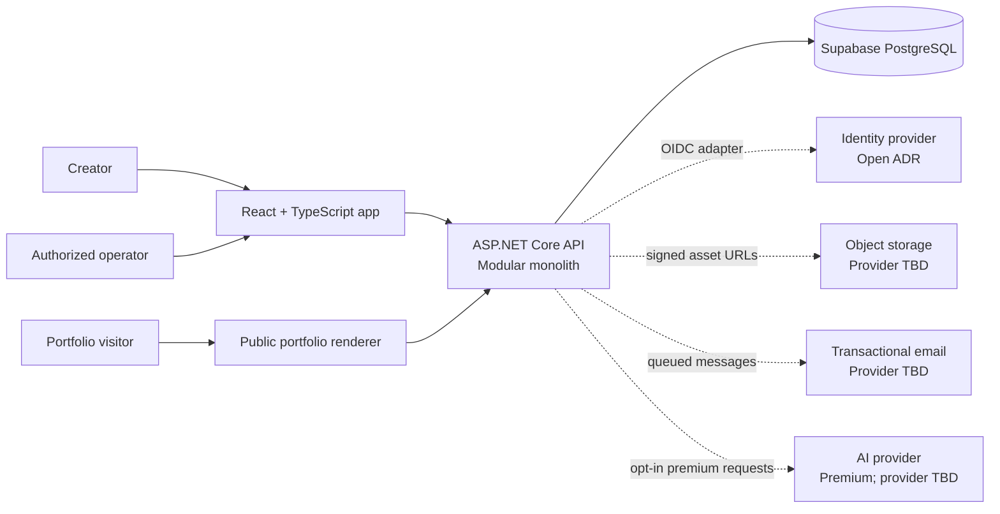
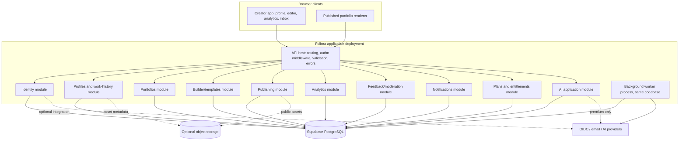

# System Context and Components

## System context

Foliora is a single product boundary: a React + TypeScript user interface and public portfolio renderer call an ASP.NET Core C# backend. The backend is a modular monolith that owns application rules and accesses Supabase-hosted PostgreSQL via EF Core/Npgsql. External identity, file storage, email and AI are behind adapters; Supabase Auth, Storage and Realtime are optional services, not required by the database decision.

## Container/component view

## Runtime shape

The initial deployment can run API and background worker as separate processes built from one repository and sharing module contracts. They are not separate business services. A transactional outbox is a proposal if reliable asynchronous side effects are required; start with the smallest reliable job mechanism that meets delivery requirements.

## Data flows

1. Creator UI calls authenticated API; the backend resolves internal actor identity and authorizes every resource.
2. Profile and draft writes use module-owned persistence and validation.
3. Publish validates a draft, produces an immutable snapshot, and atomically moves the current publication pointer.
4. Public renderer reads only published records and permitted public assets.
5. Visitor analytics and feedback use constrained anonymous endpoints with rate limits and privacy controls.
6. Background delivery handles email and retention work; AI requests are synchronous or queued based on provider latency and user experience, with quotas either way.

## Supabase boundary

Supabase is the PostgreSQL platform. The trusted C# backend uses Npgsql. Do not expose database credentials, Supabase service-role keys, or privileged tokens in React. If a future client uses Supabase APIs directly, review RLS, JWT validation, and authorization boundaries in a new ADR before enabling it.

See [[Module Boundaries|module rules]], [[../03 Database/Database Architecture and ERD|database architecture]], and [[Architecture Decision Records|decision status]].
