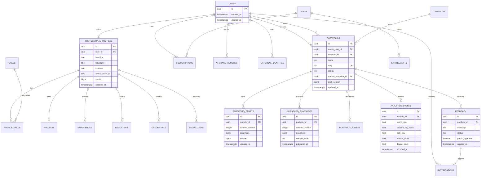

# Database Architecture and ERD

## Platform and access

The accepted platform is Supabase PostgreSQL, accessed by the ASP.NET Core backend with EF Core/Npgsql. See [[../02 Architecture/ADR-Supabase-PostgreSQL|ADR-001]]. Supabase Auth, Storage, and Realtime are optional; the auth ownership decision is still open.

Use relational tables for ownership, lifecycle, authorization-relevant state, and query dimensions. Use `jsonb` for validated, schema-versioned builder documents and immutable snapshots. Files live in object storage; PostgreSQL stores metadata and storage keys.

## Proposed conceptual ERD

The diagram is conceptual. Details are proposals and must be refined before migrations. Exact names may differ; ownership and snapshot invariants must not.

## Key constraints and indexes (proposed)

- UUID primary keys; UTC `timestamptz`; created/updated timestamps.
- `users` identity mapping depends on ADR-005; `external_identities(provider, subject)` unique if used.
- `professional_profiles.user_id` unique for one-profile-per-user baseline; reconsider only with a product requirement.
- `portfolios.slug` unique with case-insensitive normalization; reserved slugs excluded.
- A portfolio's `current_snapshot_id` must reference a snapshot of that same portfolio (enforce in service/constraint strategy).
- `portfolio_drafts.portfolio_id` unique for current draft, plus version concurrency token.
- `published_snapshots(portfolio_id, published_at)` index; immutable rows.
- Analytics indexes begin with portfolio and date; partitioning is deferred until volume justifies it.
- Feedback and notification owner/status/date indexes support inbox queries.
- Foreign-key delete behavior is explicit; do not cascade-delete evidence needed for audit or retention.

## Transaction boundaries

- Draft save: validate schema, check owner and expected version, update draft and version atomically.
- Publish: validate, create snapshot, move current pointer and set published status atomically; after commit enqueue cache invalidation/event work.
- Feedback: persist submission and durable notification intent atomically, then send email asynchronously.
- AI usage: reserve/check quota before provider call and record outcome without storing sensitive prompt content unnecessarily.

## Supabase operational notes

Use a server-side connection secret with least privilege appropriate to backend operations. Determine whether the chosen connection endpoint is direct or pooled and configure Npgsql pooling and statement behavior accordingly. Confirm connection caps, backups, PITR availability, TLS, region, migrations, and restore procedure for the selected plan before production. These are deployment decisions, not assumed product guarantees.

See [[Data Dictionary|entity definitions]], [[../02 Architecture/ADR-Supabase-Optional-Services|optional services]], and [[../09 Quality/Deployment and CI-CD|migration and environment controls]].
