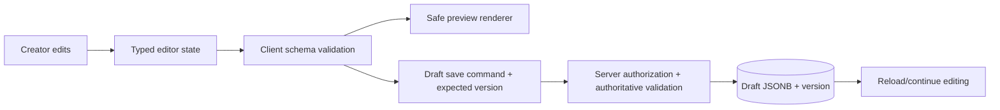

# Portfolio Builder Architecture

## Product model

The editor is a full drag-and-drop experience over a structured page: creators can compose, reorder, configure, hide, duplicate and remove supported blocks. The initial version does not execute arbitrary user HTML/JavaScript or expose a freeform CSS canvas. This gives creators meaningful control while keeping layouts responsive, secure, accessible, and renderable in public pages.

## Main concepts

- **Template:** a versioned starting layout and token set.
- **Block:** a typed section with stable ID, order, visibility, content, and constrained style options.
- **Draft document:** versioned JSONB document under active editing.
- **Published snapshot:** immutable complete public document created at publish time.
- **Renderer:** deterministic React presentation for each supported schema version.
- **Editor state:** temporary local interaction state (selection, drag overlay, undo stack) distinct from persisted business content.

## Proposed block catalog

Hero, About, Skills, Projects, Experience, Education, Credentials, Gallery, Testimonials (only approved testimonials), Contact, Custom Text (restricted rich text), and Footer. Each block declares editor controls, JSON schema, renderer, accessibility expectations, and version support.

## Editor interactions

- Add from an accessible block library.
- Reorder with pointer/touch drag and keyboard controls such as move up/down.
- Configure content using typed forms and validated field limits.
- Hide, duplicate, and delete with confirmation for destructive actions.
- Undo/redo user edits within a bounded session history.
- Preview at responsive breakpoints.
- Show saved/saving/offline/error/conflict states; preserve local edits on transient failure.
- Autosave debounce is a proposal; if used, include explicit status and server concurrency control.

## State and persistence

The client is not trusted. Validate size, block count, IDs, types, content, URLs, colors/tokens, and schema version server-side. Reject unknown schema versions unless an explicit compatibility policy is approved.

## Rendering and safety

- Render by allowlisted block type and typed props; no runtime HTML or script evaluation.
- Encode text by default. If restricted rich text is later supported, sanitize against a tight element/attribute allowlist both before persistence and at render boundary.
- Permit only safe URL schemes (`https` and explicitly necessary `mailto`); reject `javascript:`, `data:` where not required, protocol-relative surprises, and unsafe embeds.
- Use CSS variables from validated theme tokens rather than arbitrary user CSS.
- Avoid fetching arbitrary remote URLs server-side; protect against SSRF if link previews are added.
- Include alt text for meaningful images and accessible heading order/landmarks.

## Schema evolution

Every draft/snapshot has `schemaVersion`. Additive fields can be defaulted; breaking shape changes use a new version and deterministic migration. Preserve old renderer support for published snapshots through a declared compatibility window or migrate snapshots in a controlled, tested operation. Never silently reinterpret a published document.

See [[Block Configuration Schema|JSON examples]], [[Publishing Workflow|publish semantics]], and [[../06 Frontend/Frontend Architecture|frontend boundaries]].
