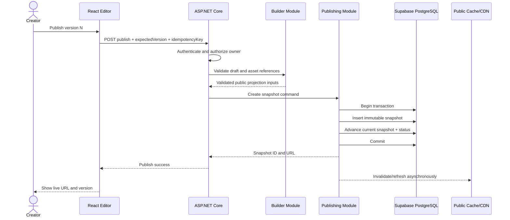

# Draft, Snapshot and Publishing Workflow

## State model

Suggested portfolio states: `draft` (never published), `published`, `unpublished`, and optionally `suspended` (moderation/system action). A published portfolio also has a current immutable snapshot ID. Draft existence and public status are separate concerns.

## Publish sequence

1. Creator requests publish with portfolio ID, expected draft version, and an idempotency key.
2. Backend authenticates and authorizes the owner.
3. Builder validates document schema, supported template, block count/content/IDs, safe URLs, asset ownership/scan status and size limits.
4. Publishing composes an explicit public projection from selected profile records and assets. Private source fields are excluded. The complete result is render-ready.
5. Calculate content hash and insert immutable snapshot with schema version and publisher/time metadata.
6. In a transaction, set current snapshot pointer and public status; enforce same-portfolio ownership of pointer.
7. Commit, then enqueue cache/CDN invalidation and publication event using durable intent when reliability requires it.
8. Return public URL and snapshot version. A retry with the same idempotency key returns the same outcome.

## Failure behavior

- Validation failure: no snapshot/pointer change; return field/block errors.
- Version mismatch: return conflict and offer reload/merge; do not overwrite newer draft.
- Storage/provider failure before commit: no pointer movement.
- Cache invalidation failure after commit: public read path checks current snapshot/version; retry invalidation and monitor stale-cache bound.
- Database failure: transaction rolls back; prior snapshot remains current.
- Public rendering error: alert and safe fallback; do not reveal private draft.

## Editing after publish

Draft writes update only the current draft. Public reads resolve current snapshot. The page does not combine live private profile rows with snapshot content; all user-facing text and chosen public fields are frozen in the snapshot. Asset URL access may be time-bound by delivery mechanism, but asset lifecycle must preserve currently published references until republish/unpublish policy allows cleanup.

## Unpublish, slug and rollback

- Unpublish is an owner-authorized state transition that removes public resolution promptly, invalidates cache, and preserves drafts/history according to retention policy.
- Slug changes are atomic and case-normalized. Reserve system paths. Decide whether prior slug redirects or returns not found; this is an open launch detail.
- Rollback should be a new publish operation that selects/recreates a prior snapshot as current under an audit record; do not mutate history.

## Public read path

Use a public lookup by normalized slug, check published status and snapshot pointer, return a narrow DTO with cache policy. Public routes must not reveal whether an unpublished private portfolio exists beyond a generic not-found response.
