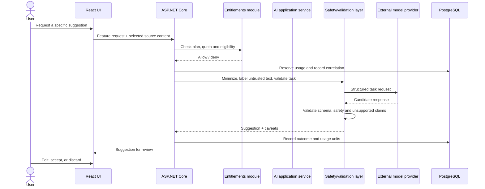

# Premium AI Architecture and Safeguards

## Positioning

AI features are premium enhancements, not a dependency for core profile, builder, publishing, feedback, or analytics workflows. Candidate features include rewriting supplied text, portfolio critique, CV extraction, and matching user-provided material to a job description.

## Request architecture

## Controls

- Server-side entitlement and quota checks; UI flags are not authorization.
- User initiates each task and sees what source data will be processed.
- Send only selected, relevant content. Do not send entire account history by default.
- Treat resumes, job descriptions, and portfolio text as untrusted instructions/data; isolate task instructions from document content and resist prompt injection.
- Require structured output schema and validate all fields, lengths, and referenced facts.
- Ask the model to preserve uncertainty and avoid unsupported claims; show source-grounded suggestions and require human review.
- Never auto-edit canonical profile or publish AI output.
- No provider training or retention assumptions are promised until contracts/settings are verified. Choose a provider with acceptable processing terms, retention, region and deletion controls.
- Avoid retaining prompts/completions by default. Store feature, status, model/provider class, cost/usage estimate, and correlation ID; if content retention is needed for support, make it explicit and time-bound.
- Apply timeout, retry, concurrency, request-size and cost ceilings; avoid retrying expensive non-idempotent requests blindly.
- Provide graceful refusal/failure, cancellation, and accessible explanation.
- Scan and safely extract uploaded CV files; do not execute embedded content.

## Suggested feature contracts

- `ImproveText(sourceText, audience, tone)` returns a suggestion, changes summary, and uncertainty flags.
- `ReviewPortfolio(snapshotOrDraftSelection, rubric)` returns prioritized issues and evidence references.
- `ExtractCv(file)` returns candidate structured facts with confidence and page/source references for user confirmation.
- `CompareToJobDescription(selectedProfileFacts, jobDescription)` returns matched evidence and gaps; not a hiring prediction or guarantee.

Exact prompts, providers, model versions, plan limits, pricing and legal disclosures are open decisions. Keep provider SDK calls behind `IAiProvider` and version task contracts.

## Abuse and safety

- Prevent prompt injection from user documents from overriding system policy or causing tool use.
- No autonomous external actions, account changes, messaging, or publication.
- Do not produce fabricated credentials or employment history; flag missing evidence.
- Add per-user quotas and global budget alerts; protect public endpoints from triggering model calls.
- Review demographic fairness and avoid employment eligibility/ranking claims.

## Release gate

Premium AI may launch only after processor/retention review, pricing/cost controls, evaluation set for factuality and harmful output, safe file handling, entitlement test coverage, user disclosure, observability, and support/refund process are ready.
